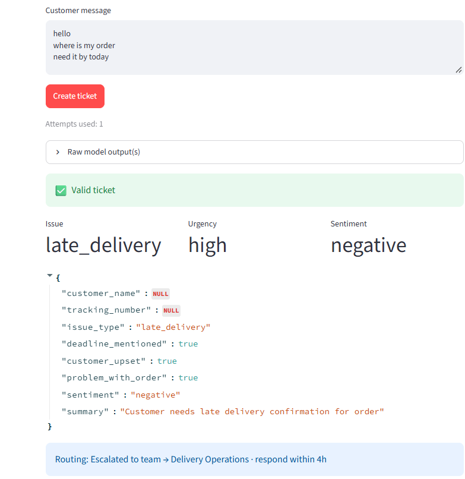
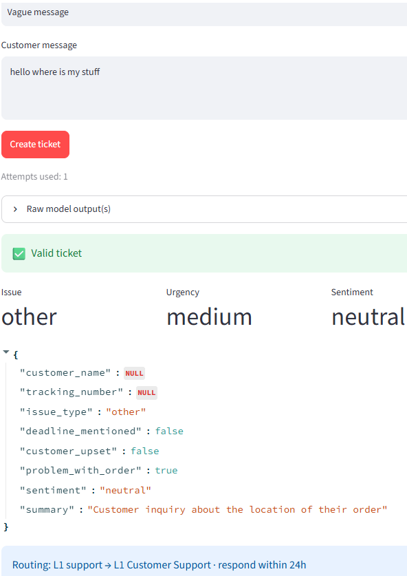
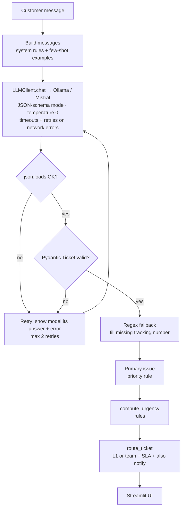

# 📦 AI Support Ticket Triage


-orange)


Turns messy customer messages about parcels and online orders into **structured support tickets**, then **routes** them to L1 support or the right team with a response-time target (SLA). It mirrors a real parcel-support workflow: *create ticket → L1 → escalate to a team*.

> "Hi, I'm Priya. My parcel 33LPX2049881 was meant to arrive last Friday… I need it by Saturday!!"

```json
{
  "customer_name": "Priya",
  "tracking_number": "33LPX2049881",
  "issues": ["late_delivery"],
  "deadline_mentioned": true,
  "customer_upset": true,
  "problem_with_order": true,
  "sentiment": "negative",
  "summary": "Parcel late, needed by Saturday for a birthday gift.",
  "issue_type": "late_delivery"
}
```
**→ Urgency: high · Escalated to Delivery Operations · respond within 4h**

---

## ✨ Features

- **LLM extraction** with a local model (Mistral 7B via Ollama) — no paid API, data stays on the machine
- **Multi-issue tickets**: the LLM lists *every* issue; a fixed priority rule picks the primary one and the other teams are notified
- **`unclear` handling**: gibberish is kept at L1 with "ask the customer for details" instead of an invented summary
- **Production-style LLM client** (`llm_client.py`): timeouts, retry with exponential backoff on network/5xx errors only, friendly errors (`ollama pull <model>`), `keep_alive` to avoid cold starts
- **Latency and token metrics** in the UI: prompt/output tokens, tokens/sec, total time, cold-start warning
- **Structured output**: JSON-schema mode (constrained decoding) generated from a Pydantic model
- **Two-step validation** (`json.loads` → Pydantic) with an **automatic retry loop** that feeds the error back to the model
- **Regex fallback** for tracking numbers the model misses
- **Deterministic urgency and routing rules** — the LLM extracts facts, code makes decisions
- **30 unit tests** that run without the LLM (mocked with `monkeypatch`), plus GitHub Actions CI
- Clean separation: `llm_client.py` (model access) · `extractor.py` (logic) · `app.py` (UI) · `test_*.py` (tests)

## 🖼️ Screenshots

| "Need it by today" → high, escalated | "Where is my stuff" → medium, L1 |
|---|---|
|  |  |

## 🏗️ Architecture



### Who decides what

| Job | Done by | Why |
|---|---|---|
| Understand the message (all issues, signals, tone, summary) | **LLM** | Needs language understanding |
| Primary issue when there are several | **Rules** (`ISSUE_PRIORITY`) | The cause beats the request: *damaged + refund → damaged* |
| Tracking number (if missed) | **Regex** | Fixed pattern — reliable, fast, free |
| Format + allowed values | **Pydantic** | Strict, typed validation |
| Urgency | **Rules** | Stable, explainable, testable |
| Routing + SLA | **Rules** | Must be predictable and auditable |

### Urgency and routing rules

| Signals from the LLM | Urgency | SLA |
|---|---|---|
| `deadline_mentioned` or `customer_upset` | high | 4h |
| only `problem_with_order` | medium | 24h |
| none | low | 72h |

Primary issue priority: `damaged > lost > wrong_address > late_delivery > refund > other > unclear`.

Escalate to a team if urgency is **high** or the primary issue is **damaged / lost / refund**; otherwise **L1 Customer Support**. Teams for any other issues go in `also_notify`. `unclear` messages always stay at L1 with the next action "ask the customer for more details".

| Issue type | Team (when escalated) |
|---|---|
| late_delivery | Delivery Operations |
| lost | Investigations |
| damaged | Claims & Damages |
| wrong_address | Address & Redirection |
| refund | Customer Payments |
| other | General Enquiries |
| unclear | L1 Customer Support |

*Team names are examples and can be changed in `TEAM_FOR_ISSUE`.*

## 🚀 Getting started

**Prerequisites:** Python 3.10+, [Ollama](https://ollama.com) installed and running.

```bash
git clone https://github.com/MahaSra1/ai-support-ticket-triage.git
cd ai-support-ticket-triage

python -m venv venv
# Windows:  venv\Scripts\activate
# macOS/Linux:  source venv/bin/activate

pip install -r requirements.txt
ollama pull mistral        # 16 GB RAM; on 8 GB use: ollama pull llama3.2:3b

python -m streamlit run app.py          # opens http://localhost:8501
```

Optional — use a different model:
```bash
# PowerShell
$env:LLM_MODEL="qwen2.5:7b"
# macOS/Linux
export LLM_MODEL=qwen2.5:7b
```

## 🧪 Tests

```bash
python -m pytest -v
```

The LLM call is replaced with a fake (`monkeypatch`), so tests run in under a second, cost nothing and give the same result every time.

| Area | What is tested |
|---|---|
| Validation | valid JSON, non-JSON, disallowed values, null vs missing keys |
| Retry | recovers after a bad answer; gives up after max retries |
| Regex | fills a missed tracking number; never invents one |
| Urgency | high (deadline / upset), medium (problem only), low |
| Routing | damaged → Claims & Damages; high → 4h SLA; simple question → L1 |
| Multi-issue | cause beats request; duplicates removed; second team notified; `issue_type` not in the LLM schema |
| Unclear | gibberish stays at L1, low urgency, asks for details |
| LLM client | metrics maths, `options` payload, 404 → pull hint, retries 5xx, never retries 4xx, Ollama-down message |

## 🔧 Challenges I solved

| Problem found during testing | Fix | Technique |
|---|---|---|
| Schema mode returned **valid JSON with empty name/tracking** (the tracking number even appeared in the summary) | Required fields with descriptions in the schema | Schema design |
| Tracking number still null in strict mode | Deterministic **regex fallback** | LLM + plain code |
| Making fields required broke an existing test | Updated tests to document the new contract | Contract testing |
| Vague messages rated **high urgency** | Few-shot examples | Prompt engineering |
| Urgency **changed when the same question was reworded** | Redesign: LLM extracts yes/no facts, **rules compute urgency** | Facts vs decisions |
| `NameError` in the UI after adding routing | Moved import to the top of the file | Debugging / PEP 8 |
| Mistral and Llama 3.2 3B **disagreed** on "box crushed, I want my money back" (damaged vs refund) | LLM lists all issues; a **priority rule** picks the primary | Facts vs decisions |
| "Late AND I moved house" lost the *late* part (only one issue allowed) | `issues` list + `also_notify` teams | Schema design |
| Gibberish produced **valid JSON with an invented summary** | `unclear` issue + few-shot example + "only describe what the customer wrote" | Valid ≠ correct |
| Raw `requests.post` had no retry, hung on slow CPU, and showed raw stack traces | `LLMClient` with timeouts, backoff and friendly errors | Production engineering |
| 64 s waits on first call (cold start); 0.7 tok/s on an 8 GB laptop | `keep_alive`, metrics in UI, smaller model option | Latency measurement |

**Key lesson:** valid output is not the same as correct output. Validation catches format errors; meaning errors need clear prompts, examples, deterministic rules and evaluation.

## ⚠️ Known limitations

- The tracking-number regex is generic and can match words like `SATURDAY2024`; production would use each carrier's exact format.
- Sentiment and `customer_upset` are still LLM judgements and can be inconsistent on short messages.
- The LLM can still miss an issue in a long message; the priority rule only helps once issues are listed.
- No evaluation set yet — accuracy is checked manually on sample messages.
- Single message at a time; no batch processing.

## 🏢 How this would run in production

| This project | Production |
|---|---|
| Ollama + Mistral on a laptop | Azure OpenAI / AWS Bedrock in an Australian region, or self-hosted vLLM |
| Streamlit button | FastAPI endpoint behind a queue, called by the CRM / email system |
| Prompt in a Python string | Versioned prompts, A/B tested |
| Unit tests | Unit tests + labelled evaluation set measuring field accuracy |
| Names in prompts | PII masking and data-retention rules |
| Retry loop | Retry + fallback model + human-review queue |

## 🗺️ Roadmap

- [ ] Evaluation set (50+ labelled messages) with field-level accuracy
- [ ] CSV batch upload → ticket table → download
- [ ] FastAPI endpoint (`POST /tickets`)
- [ ] L1 auto-answers with a RAG FAQ chatbot (delivery and returns policies)
- [ ] Agent that looks up tracking status with tool calling
- [ ] Docker + cloud deployment

## 🧰 Tech stack

Python · Ollama (REST API) · Mistral 7B / Llama 3.2 3B · Pydantic v2 · Streamlit · Requests · Regex · Pytest · GitHub Actions

## 👩‍💻 Author

**Mahalaxmi (Maha)** — Python engineer moving from automotive ADAS validation into AI engineering.
GitHub: [@MahaSra1](https://github.com/MahaSra1)

## 📄 License

MIT — see [LICENSE](LICENSE).
